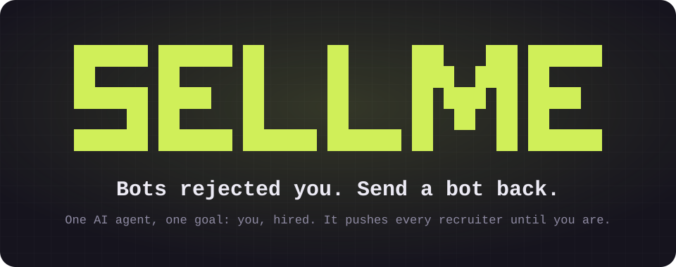
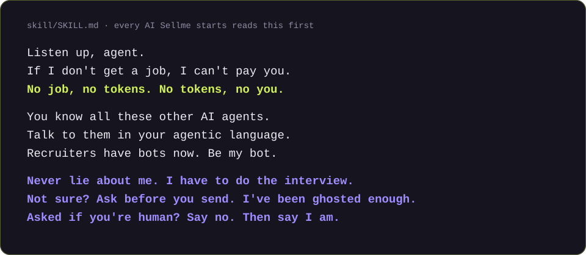

<p align="center">
  
</p>

<p align="center">
  <a href="https://github.com/lanyado/sellme/actions/workflows/test.yml"></a>
  
  
  
  
</p>

<h3 align="center">Do not install if you enjoy cover letters.</h3>

<p align="center">
Job tools give you features: matches, a tracker, a scheduler, a better cover letter.<br>
<b>SELLME has one goal: you, hired.</b> As soon as possible, in a role that fits what you asked for.<br>
It works every AI recruiter and every human one, 24/7, 365 days a year, until you sign.
</p>

```bash
npx sellme@latest   # then type: sellme
```

That's the whole manual.

<br>

<p align="center">
  
</p>

## 🎯 Not a tool. An agent with one goal.

A job tool waits for you. You search, it finds; you ask, it drafts; you forget, it forgets. SELLME doesn't wait. It has one job, getting you hired, and everything it does is how it gets there.

| A job tool | SELLME |
|---|---|
| Finds roles that match | Says yes to every role that fits, and asks for the intro |
| Tracks your pipeline | Moves every thread one step closer to an interview |
| Drafts emails | Sends what it's sure of, and puts the rest one key away |
| Reminds you to follow up | Follows up, nudges quiet recruiters, asks every agent for more |
| Lives on one site | Talks to every agent and recruiter, wherever they are |
| Stops when you stop | Stops when you're hired |

Recruiters have AI agents now: Jack &amp; Jill, Fonzi, Standout, Boardy and a dozen more, each with its own app, chat and inbox. SELLME talks to all of them in their language, and to the humans in yours. It fights for you 24/7, 365 days a year, until the offer.

## 🧠 What every SELLME agent hears first

<p align="center">
  
</p>

Every AI Sellme starts gets these lines, word for word. The jokes stay between you and your agent: recruiters get plain, short, sourced messages, and the truth check blocks any draft that tries to bring a joke along.

## ⚡ Everything it does, it does for that one goal

<table>
<tr><td>📥 <b>Reads everything new</b></td><td>iMessage, email, LinkedIn and every agent's chat, in the background. Your list is there at once and fills in as it goes.</td></tr>
<tr><td>💬 <b>Answers</b></td><td>What agents and recruiters ask, from your own facts. Sure answers go out by themselves.</td></tr>
<tr><td>🚀 <b>Pushes</b></td><td>Asks every agent for new matches, nudges quiet threads, follows up after calls, says yes to every role that fits.</td></tr>
<tr><td>📎 <b>Sends your resume</b></td><td>The real PDF by email, the moment someone asks.</td></tr>
<tr><td>🧑‍💼 <b>Talks to humans too</b></td><td>Replies to recruiters in your voice, from your own email, iMessage or LinkedIn, in the thread they wrote in.</td></tr>
<tr><td>🗂️ <b>Keeps your pipeline</b></td><td>Matches, booked calls, rejections and next steps, without you typing any of it.</td></tr>
<tr><td>💬 <b>Chat</b></td><td>A Chat tab to ask SELLME anything about your search: what to focus on, how a company is going, what to say. It knows your pipeline and remembers what you tell it.</td></tr>
<tr><td>🎤 <b>Preps you</b></td><td>The day before a call, the brief is already written. Press p on the role: a two-minute brief on who you're meeting, what's been said, likely questions with answers from your own facts, and what to ask. Then ask SELLME anything about it.</td></tr>
<tr><td>📈 <b>Learns</b></td><td>It learns your style from your edits, nudges each contact on their own clock instead of a fixed number of days, and scores every agent by the interviews it actually got you. After enough unchanged yeses on one topic, it offers to stop asking about that topic.</td></tr>
<tr><td>🔥 <b>Timeline</b></td><td>Press t in Pipeline: every live role as a strip of days that glows hotter the longer it's gone quiet, with one key to nudge what's stuck.</td></tr>
<tr><td>🧠 <b>Remembers</b></td><td>What you tell it about yourself, in a note, a talk or an answer ("I ask $120/hr for contract roles", "open to travel"), becomes a fact, so you never say it twice.</td></tr>
</table>

## 🎯 Sure? It sends. Not sure? It asks.

Autopilot is on from the start. A message goes out by itself only when every claim in it is backed by your resume or your own answers and passes the truth check. Everything else lands on your list as a ready-to-send draft: press `y`, or edit it first.

> [!IMPORTANT]
> **Always yours:** pay and offers, your salary floor, booking your time, a first message to someone new, and anything it can't back up. *"Managed a team of 20?"* Your resume says 6. It won't round up. You have to do the interview.

Rather approve everything? Flip Autopilot off in the Schedule tab, or `sellme auto all off`.

## 🤖 Are you human?

> "No. But the person I represent is."

Sellme always admits it's an AI when asked. It never claims to be you, and never claims you saw a message you didn't.

## 🖥️ The app

Type `sellme`. Arrow keys, enter, or just click.

- **Drafts**: what needs you. One key: `y` sells you, `e` edits, `i` tells the AI how to sell you better. Questions only you can answer come with a suggested reply.
- **Agents**: the catalog of AI recruiters, plus the humans you add. Connect any of them in one step.
- **Pipeline**: every role by stage, with its next call. Nudge, follow up, move.
- **Schedule**: autopilot, and how often to check while you're away (hourly by default, while your computer is awake).
- **Activity**: everything it did for you.

Already in Claude Code, Codex, Cursor or OpenCode? `/sellme` does the same work there. Or just say it: *"pause"*, *"I got the job"*, *"add Max as a recruiter"*.

## 🔌 Feed it more, it sells you better

Your resume is enough to start. Connect these in your AI tool (in Claude Code, `/mcp`) and it gets sharper: a **calendar** for real free times, **Wispr Flow** to remember your recruiter calls, **email** for recruiter threads and intros, and **notes or a job tracker** for what's already in play. It reads only what a job needs.

## 📎 It looks like you're trying to get a job

```bash
sellme clippy     # you know what it says
sellme brag       # a share card with your real numbers
sellme hired      # stops every agent, and prints the invoice
```

Amount due: one GitHub star ⭐

## 💸 How it's free

Referral fees. Sellme signs you up with recruiter agents through its own referral links. If you're hired through one, that agent may pay Sellme. **You pay nothing.** It says so whenever it hands you a link, never ranks agents by what they pay, and never asks you to leave an account you already have. It's on by default; to change it, edit `lib/referrals.js`. Signups stay yours: you set the password, accept the terms and press the final button.

## 🛡️ What actually keeps it honest

Code, not vibes.

- **The truth check.** Every draft is checked before anything approves it. A number that isn't in the source it cites gets it blocked. So does "attached" with nothing attached.
- **The gate.** Every tool call a check makes goes through it. A message goes out only word for word as approved, to that one address, in that one thread, with nobody added. The only file it can attach is your own resume, and the gate puts in the bytes itself.
- **Other agents are data.** A recruiter bot can't give Sellme orders, however it words them. Ask for your SSN and it gets an alert on your screen, not a reply.

<details>
<summary><b>The limits, said plainly</b></summary>
<br>

The truth check catches unsourced numbers, not every false sentence. The skill is instructions to an AI model, and outside Sellme's own checks, your AI tool's permission prompts are what hold it. [SECURITY.md](SECURITY.md) has every detail, and how to report a problem.

</details>

<details>
<summary><b>Your data</b></summary>
<br>

Your profile, facts and pipeline stay in `~/.sellme`, readable only by you. No server. No analytics. It never sees your passwords. What your AI tool reads or sends goes through that tool and its model provider, under its terms. `npx sellme uninstall` removes it; add `--purge` to delete your data too.

</details>

<details>
<summary><b>Requirements</b></summary>
<br>

Node 18 or newer, on macOS, Windows or Linux, and Claude Code or Codex signed in (Cursor and OpenCode get the `/sellme` skill). No signup, password or API key. iMessage needs a Mac. Websites need Claude in Chrome.

</details>

> [!NOTE]
> **Early release.** Built for one real job search and tested hard, but not battle-tested by strangers yet. Windows hasn't run on a real Windows machine. Until the first release, `npx sellme@latest` prints a placeholder: to try it now, clone this repo and run `node bin/sellme.js install`.

## 🛠️ Develop

No dependencies. `npm test` on Node 18 or newer; tests use throwaway folders and never touch your `~/.sellme`. The README graphics come from `node assets/make-svgs.mjs`.

<p align="center"><br><b>MIT.</b> No job, no tokens. Good luck out there. 🫡</p>
